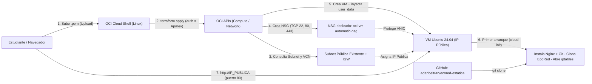

# Despliegue Automatizado de una VM en Oracle Cloud Infrastructure (OCI) con Terraform desde OCI Cloud Shell

Guía práctica y paso a paso para aprovisionar automáticamente una máquina virtual **Ubuntu 24.04** en **Oracle Cloud Infrastructure (OCI)** mediante **Infraestructura como Código (Terraform)** ejecutado directamente en **OCI Cloud Shell** con carga de la **API Private Key (`.pem`)**, y publicar de forma desatendida la aplicación web estática **[EcoRed Circular](https://github.com/adanbeltran/ecored-estatica)** usando **Nginx** y **`cloud-init`**.

> **¿Qué resuelve este proyecto?**
> Cuando una máquina virtual se configura manualmente por SSH después de crearla, al destruirla (`terraform destroy`) y volverla a levantar (`terraform apply`), la nueva instancia nace vacía y con una IP distinta, por lo que el navegador no muestra nada. En esta guía el aprovisionamiento del servidor web (**Nginx**), la clonación del repositorio (**Git**) y la apertura persistente del firewall interno (**`iptables`**) se inyectan automáticamente mediante **`cloud-init` (`user_data`)**. Así, cada vez que ejecutes `terraform apply`, la nueva IP pública publicará la página web sin intervención manual.

---

## Tabla de Contenidos

1. [Conceptos Fundamentales](#1-conceptos-fundamentales)
2. [Arquitectura de la Solución](#2-arquitectura-de-la-solución)
3. [Estructura del Repositorio](#3-estructura-del-repositorio)
4. [Prerrequisitos](#4-prerrequisitos)
5. [Guía Paso a Paso](#5-guía-paso-a-paso)
   - [Paso 1: Obtener los OCIDs y verificar la Subnet pública en OCI](#paso-1-obtener-los-ocids-y-verificar-la-subnet-pública-en-oci)
   - [Paso 2: Generar la API Key y descargar la Private Key (`.pem`)](#paso-2-generar-la-api-key-y-descargar-la-private-key-pem)
   - [Paso 3: Habilitar OCI Cloud Shell y cargar el archivo de la Private Key](#paso-3-habilitar-oci-cloud-shell-y-cargar-el-archivo-de-la-private-key)
   - [Paso 4: Verificar e instalar herramientas (OCI Cloud Shell o equipo local)](#paso-4-verificar-e-instalar-herramientas-oci-cloud-shell-o-equipo-local)
   - [Paso 5: Clonar este repositorio y preparar las llaves (`API Key` y `SSH`)](#paso-5-clonar-este-repositorio-y-preparar-las-llaves-api-key-y-ssh)
   - [Paso 6: Configurar tus variables en `terraform.tfvars`](#paso-6-configurar-tus-variables-en-terraformtfvars)
   - [Paso 7: Entender qué automatizan `main.tf` y `cloud-init.sh.tftpl`](#paso-7-entender-qué-automatizan-maintf-y-cloud-initshtftpl)
   - [Paso 8: Ejecutar Terraform (`init`, `validate`, `plan` y `apply`)](#paso-8-ejecutar-terraform-init-validate-plan-y-apply)
   - [Paso 9: Verificar el aprovisionamiento y abrir la IP pública en el navegador](#paso-9-verificar-el-aprovisionamiento-y-abrir-la-ip-pública-en-el-navegador)
   - [Paso 10: Probar destrucción y recreación automatizada (`destroy` → `apply`)](#paso-10-probar-destrucción-y-recreación-automatizada-destroy--apply)
6. [Solución de Problemas Comunes (Troubleshooting)](#6-solución-de-problemas-comunes-troubleshooting)
7. [Buenas Prácticas de Seguridad](#7-buenas-prácticas-de-seguridad)
8. [Lista de Capturas de Pantalla Sugeridas](#8-lista-de-capturas-de-pantalla-sugeridas)

---

## 1. Conceptos Fundamentales

Antes de ejecutar comandos, conviene entender el rol de cada pieza tecnológica que interviene en este flujo:

* **Infraestructura como Código (IaC):** Práctica de definir servidores, redes y reglas de seguridad en archivos de texto versionables (código) en lugar de hacer clics manuales en la consola web. Garantiza reproducibilidad, trazabilidad y despliegue rápido.
* **Terraform:** Herramienta de IaC declarativa de HashiCorp. Tú describes el *estado deseado* (archivos `.tf`) y Terraform se comunica con las APIs del proveedor de nube para crear, actualizar o destruir los recursos necesarios.
* **Provider (`oracle/oci`):** Complemento oficial que traduce el código de Terraform en llamadas HTTPS firmadas hacia las APIs REST de Oracle Cloud Infrastructure.
* **Data Sources vs. Resources:**
  * Un `data` source **solo lee** información existente en OCI (por ejemplo, la subnet que ya tienes creada o el catálogo oficial de imágenes de Ubuntu).
  * Un `resource` **crea, modifica y destruye** infraestructura gestionada por Terraform (como el NSG y la máquina virtual).
* **Terraform State (`terraform.tfstate`):** Archivo que registra qué recursos creó Terraform y sus IDs reales en OCI. Permite saber qué cambiar en futuros `apply` y qué eliminar en un `destroy`. Nunca se sube a Git porque puede contener metadatos sensibles.
* **OCID (Oracle Cloud Identifier):** Identificador único global asignado a cada recurso en OCI (Tenancy, User, Compartment, VCN, Subnet, Instance, etc.) con el formato `ocid1.<tipo>.<realm>.<región>.<id>`.
* **Tenancy y Compartment:** El *Tenancy* es tu cuenta raíz en OCI; los *Compartments* son carpetas lógicas que agrupan y aíslan recursos y permisos IAM dentro del tenancy.
* **VCN, Subnet Pública, Internet Gateway y Route Table:**
  * La **VCN** (*Virtual Cloud Network*) es tu red privada virtual en la nube.
  * Una **Subnet pública** permite asignar IPs públicas a las instancias (`prohibit_public_ip_on_vnic = false`).
  * Para que exista comunicación real con internet, la subnet debe tener una **Route Table** con una ruta por defecto (`0.0.0.0/0`) apuntando a un **Internet Gateway (IGW)**.
* **Security List vs. Network Security Group (NSG):** Ambos actúan como firewalls virtuales a nivel de OCI. Mientras una *Security List* aplica a **toda** la subnet, un **NSG** se asocia directamente a la tarjeta de red (VNIC) de nuestra VM. Usar un NSG propio permite abrir los puertos `22`, `80` y `443` sin alterar las reglas compartidas de la subnet existente.
* **OCI Cloud Shell:** Terminal Linux integrada directamente dentro de la consola web de OCI. Incluye `terraform`, `git`, `ssh-keygen` y `oci` CLI preinstalados y permite cargar archivos locales (como la API Private Key `.pem`) desde el navegador.
* **API Key (`.pem`) vs. Llave SSH (`id_ed25519`):**
  * La **API Key (`.pem`) + Fingerprint** autentica a **Terraform** contra las **APIs de OCI** para crear/destruir recursos en tu cuenta.
  * El **par de llaves SSH** autentica tu acceso como usuario **`ubuntu`** dentro del sistema operativo de la **máquina virtual** por el puerto `22`.
* **`cloud-init` (`user_data`):** Mecanismo estándar en la nube que ejecuta un script automáticamente durante el **primer arranque** del sistema operativo Linux (recibido en base64 a través de los metadatos de la VM). Lo usamos para instalar Nginx, clonar la aplicación web y configurar el firewall local sin intervención humana.
* **Doble capa de firewall en OCI (NSG + `iptables`):** En OCI, abrir el puerto `80` en la consola/NSG **no es suficiente** en Ubuntu. Las imágenes oficiales de Ubuntu en OCI traen un firewall interno (`iptables`) que bloquea todo tráfico entrante excepto SSH (`22`). Por eso `cloud-init` abre y persiste explícitamente los puertos `80` y `443` en `iptables`.

---

## 2. Arquitectura de la Solución



---

## 3. Estructura del Repositorio

Este repositorio está diseñado como plantilla limpia (**sin credenciales ni variables personales**):

```text
.
├── .gitignore                  # Protege terraform.tfvars, *.pem, keys/ y *.tfstate
├── README.md                   # Esta guía paso a paso
├── versions.tf                 # Versión mínima de Terraform (>= 1.5) y proveedor oracle/oci
├── providers.tf                # Configura el proveedor OCI con auth = "ApiKey" y pathexpand()
├── variables.tf                # Definición tipada de todas las variables del despliegue
├── main.tf                     # Data sources, NSG, reglas de puertos, cloud-init y VM
├── outputs.tf                  # Muestra IP pública, IP privada, URL web y comando SSH
├── terraform.tfvars.example    # Plantilla con variables vacías para que completes con TU cuenta
├── keys/
│   └── .gitkeep                # Carpeta local donde guardarás oci_api_key.pem y tus llaves SSH
├── docs/
│   └── screenshots/
│       └── .gitkeep            # Carpeta destinada a las capturas de pantalla de la guía
└── scripts/
    ├── cloud-init.sh.tftpl     # Script ejecutado automáticamente al arrancar la VM
    ├── setup-cloudshell.sh     # Asistente opcional para configurar la Private Key en Cloud Shell
    └── deploy-ecored.sh        # Script opcional para actualizar la app web en vivo
```

---

## 4. Prerrequisitos

Antes de empezar asegúrate de contar con:

1. **Una cuenta activa de Oracle Cloud Infrastructure (OCI)** (capa *Always Free*, *Free Trial* o de pago).
2. **Una VCN con una Subnet pública existente** en tu región, cuya **Route Table** tenga una regla `0.0.0.0/0` dirigida a un **Internet Gateway**.
3. **Permisos para usar OCI Cloud Shell** (si eres administrador del tenancy ya los tienes activos; en el Paso 3 se muestran las políticas IAM requeridas para usuarios no administradores).
4. **Acceso a internet** desde el navegador para abrir la Consola de OCI y probar la IP pública generada.

---

## 5. Guía Paso a Paso

### Paso 1: Obtener los OCIDs y verificar la Subnet pública en OCI

**¿Por qué se hace?**
Terraform necesita identificadores exactos (`OCID`) para saber en qué cuenta, usuario, compartimento, región y subred debe consultar imágenes y aprovisionar la máquina virtual. Además, verificar previamente que la subnet sea pública y tenga salida por Internet Gateway evita que la VM quede inaccesible tras desplegarse.

**Qué hacer en la Consola de OCI (`https://cloud.oracle.com`):**
1. **Región (`region`):** Mira el selector superior derecho de la consola (ej. `Brazil East (Sao Paulo)` corresponde al identificador `sa-saopaulo-1`; `US East (Ashburn)` corresponde a `us-ashburn-1`).
2. **Tenancy OCID (`tenancy_ocid`):** Haz clic en el icono de **Perfil** (arriba a la derecha) → **Tenancy: \<tu-tenancy\>** → copia el campo **OCID**.
3. **User OCID (`user_ocid`):** Haz clic en **Perfil** → **My profile** (o **User settings**) → copia el campo **OCID**.
4. **Compartment OCID (`compartment_ocid`):** Menú hamburguesa (☰) → **Identity & Security** → **Compartments** → selecciona el compartimento donde vas a desplegar (o el compartimento raíz, cuyo OCID coincide con el del Tenancy) y copia su **OCID**.
5. **Subnet OCID (`subnet_ocid`) y validación de internet:**
   - Menú (☰) → **Networking** → **Virtual Cloud Networks** → entra a tu VCN.
   - Entra a tu **Subnet pública** y copia su **OCID**.
   - Verifica que indique **Public Subnet** (no *Private Subnet*).
   - Haz clic en la **Route Table** asociada a esa subnet y confirma que exista una regla con **Target Type: Internet Gateway** y **Destination CIDR Block: `0.0.0.0/0`**.

> 📸 **Espacio para captura de pantalla:** Consola de OCI mostrando la ubicación de los OCIDs (Tenancy / User / Compartment) y la Subnet pública con su Route Table hacia el Internet Gateway.
>
> 

---

### Paso 2: Generar la API Key y descargar la Private Key (`.pem`)

**¿Por qué se hace?**
OCI no permite autenticar Terraform con usuario y contraseña web. En su lugar emplea criptografía asimétrica RSA: OCI almacena tu **llave pública** (identificada por su **Fingerprint**) y Terraform firma cada petición API usando tu **llave privada (`.pem`)**.

**Qué hacer en la Consola de OCI:**
1. Haz clic en el icono de **Perfil** (arriba a la derecha) → **My profile** (o **User settings**).
2. En el panel izquierdo (sección *Resources*), selecciona **Tokens and keys** → **API keys**.
3. Haz clic en **Add API key**.
4. Selecciona **Generate API key pair**.
5. Haz clic en **Download private key** y guarda el archivo `.pem` en un lugar seguro de tu equipo (esta es la única vez que OCI te permite descargarlo).
6. Haz clic en **Add**.
7. En la ventana *Configuration file preview* que aparece inmediatamente, copia el valor de **`fingerprint`** (formato `xx:xx:xx:...`).

> 📸 **Espacio para captura de pantalla:** Ventana de creación de API Key en OCI mostrando el botón *Download private key* y el resumen con el *Fingerprint* generado.
>
> 

---

### Paso 3: Habilitar OCI Cloud Shell y cargar el archivo de la Private Key

**¿Por qué se hace?**
Ejecutar Terraform dentro de **OCI Cloud Shell** evita problemas de instalación local en Windows/macOS, bloqueos de red corporativos y diferencias de sistema operativo. Además, en este ejercicio requerimos **habilitar y usar la carga del archivo de la Private Key (`.pem`) directamente en OCI Cloud Shell** para que Terraform autentique explícitamente mediante `auth = "ApiKey"` con el archivo cargado.

#### 3.1 Habilitar permisos de Cloud Shell (solo si tu usuario NO es administrador)
Si al abrir Cloud Shell aparece un mensaje de permisos insuficientes, un administrador del tenancy debe crear una política en **Identity & Security → Policies** con estas dos sentencias:

```text
allow group <nombre-de-tu-grupo> to use cloud-shell in tenancy
allow group <nombre-de-tu-grupo> to use cloud-shell-public-network in tenancy
```

*(Los usuarios del grupo `Administrators` ya tienen Cloud Shell y la opción de carga habilitadas por defecto).*

#### 3.2 Abrir OCI Cloud Shell y verificar red pública
1. En la barra superior derecha de la Consola de OCI, haz clic en el icono **Developer Tools (`>_`)** → **Cloud Shell**.
2. Espera ~20 segundos a que se inicie tu terminal Linux en la parte inferior del navegador.
3. En la barra superior de Cloud Shell, verifica que el modo de red sea **Public network** (necesario para clonar repositorios de GitHub y probar conexiones hacia la IP pública de la VM).

> 📸 **Espacio para captura de pantalla:** Consola de OCI abriendo *Cloud Shell* desde el icono `>_` y mostrando la terminal lista en modo *Public network*.
>
> 

#### 3.3 Cargar el archivo de la Private Key (`.pem`) en OCI Cloud Shell
1. En la esquina superior derecha de la ventana de **OCI Cloud Shell**, haz clic en el menú de acciones (**icono de engranaje ⚙️** o menú `≡`).
2. Selecciona la opción **Upload** (**Cargar**).
3. En el cuadro emergente, haz clic en **Select from your computer** (o arrastra el archivo) y elige el archivo `.pem` de tu Private Key descargado en el Paso 2.
4. Haz clic en **Upload**. OCI Cloud Shell guardará el archivo directamente en tu directorio personal (`~/`).
5. Confirma en la terminal de Cloud Shell que el archivo se cargó correctamente:

```bash
ls -la ~/*.pem
```

> 📸 **Espacio para captura de pantalla:** Menú de engranaje (⚙️ → *Upload*) en OCI Cloud Shell subiendo el archivo `.pem` de la Private Key y la salida del comando `ls -la ~/*.pem`.
>
> 

---

### Paso 4: Verificar e instalar herramientas (OCI Cloud Shell o equipo local)

**¿Por qué se hace?**
Necesitamos confirmar que `terraform` (`>= 1.5.0`), `git` y `ssh-keygen` estén disponibles en el entorno donde ejecutaremos la automatización.

#### Opción A: En OCI Cloud Shell (Recomendado)
OCI Cloud Shell ya incluye todas las herramientas preinstaladas. Verifica sus versiones ejecutando:

```bash
terraform version
git --version
ssh-keygen -V 2>&1 | head -n 1
```

> **¿Qué hacer si en tu Cloud Shell `terraform` fuera menor a `1.5.0` o no estuviera disponible?**
> Puedes instalar el binario oficial en tu carpeta de usuario (`~/bin`) sin requerir permisos `root`:
> ```bash
> mkdir -p ~/bin
> curl -sLO https://releases.hashicorp.com/terraform/1.10.5/terraform_1.10.5_linux_amd64.zip
> unzip -o terraform_1.10.5_linux_amd64.zip -d ~/bin
> rm -f terraform_1.10.5_linux_amd64.zip
> export PATH="$HOME/bin:$PATH"
> echo 'export PATH="$HOME/bin:$PATH"' >> ~/.bashrc
> terraform version
> ```

#### Opción B: Si prefieres ejecutarlo en un equipo local (Windows / Linux)
* **Windows (PowerShell):**
  ```powershell
  winget install --id Hashicorp.Terraform --exact --accept-source-agreements --accept-package-agreements
  winget install --id Git.Git --exact --accept-source-agreements --accept-package-agreements
  ```
* **Ubuntu / Debian:**
  ```bash
  sudo apt-get update && sudo apt-get install -y gnupg software-properties-common git openssh-client
  ```
  *(Y sigue la instalación oficial del repositorio APT de HashiCorp para `terraform`).*

---

### Paso 5: Clonar este repositorio y preparar las llaves (`API Key` y `SSH`)

**¿Por qué se hace?**
1. Al clonar el repositorio obtienes todo el código Terraform limpio y reutilizable.
2. Mover tu `.pem` a `./keys/oci_api_key.pem` y aplicar **`chmod 600`** es obligatorio en Linux: si una llave privada tiene permisos de lectura para otros usuarios, tanto OpenSSH como los clientes de seguridad la rechazan por riesgo de exposición.
3. Generar un par de llaves **SSH `ed25519`** (`./keys/oci_vm_key` y `./keys/oci_vm_key.pub`) permite que Terraform inyecte tu llave pública en la VM para poder conectarte como `ubuntu` si necesitas inspeccionar logs o administrar el servidor.

Ejecuta en **OCI Cloud Shell**:

```bash
# 1. Clonar el repositorio (reemplaza la URL por la de tu repositorio publicado en GitHub)
git clone <URL_DE_ESTE_REPOSITORIO_EN_GITHUB>
cd <NOMBRE_DE_LA_CARPETA_DEL_REPOSITORIO>
```

Ahora puedes preparar las llaves **de forma asistida** (Opción 1) o **manualmente** (Opción 2):

#### Opción 1: Usar el script asistente para OCI Cloud Shell (Recomendado)
El script detecta automáticamente el archivo `.pem` que cargaste en `~/`, te pregunta cuál usar (o acepta la ruta como parámetro), aplica `chmod 600`, genera el par SSH y crea `terraform.tfvars` desde la plantilla vacía:

```bash
bash scripts/setup-cloudshell.sh
```
*(También puedes indicar la ruta directamente: `bash scripts/setup-cloudshell.sh ~/nombre_de_tu_llave.pem`).*

#### Opción 2: Hacerlo paso a paso manualmente
```bash
# Copiar la Private Key cargada en Cloud Shell dentro de ./keys/ y proteger permisos
cp ~/NOMBRE_DE_TU_ARCHIVO.pem ./keys/oci_api_key.pem
chmod 600 ./keys/oci_api_key.pem

# Generar par de llaves SSH ed25519 sin contraseña (para conectarte por SSH a la VM)
ssh-keygen -t ed25519 -f ./keys/oci_vm_key -N "" -C "oci-vm-automatic"
chmod 600 ./keys/oci_vm_key

# Crear tu archivo personal de variables a partir de la plantilla vacía
cp terraform.tfvars.example terraform.tfvars

# Verificar que existan las 3 llaves con permisos correctos
ls -la ./keys/
```

> 📸 **Espacio para captura de pantalla:** Terminal de OCI Cloud Shell mostrando el repositorio clonado, la copia de la Private Key a `./keys/oci_api_key.pem` con permisos `-rw-------` (`600`) y la generación del par SSH.
>
> 

---

### Paso 6: Configurar tus variables en `terraform.tfvars`

**¿Por qué se hace?**
El repositorio incluye `terraform.tfvars.example` con todos los campos personales vacíos (`""`) para que ninguna credencial quede expuesta en GitHub. Al copiarlo a `terraform.tfvars` (archivo protegido en `.gitignore`), le entregas a Terraform los datos reales de **tu** cuenta sin riesgo de subirlos por accidente a Git.

Abre `terraform.tfvars` con el editor `nano` en OCI Cloud Shell:

```bash
nano terraform.tfvars
```

Completa únicamente los campos vacíos con los valores obtenidos en los Pasos 1 y 2:

```hcl
# --- Autenticación con tu cuenta de OCI ---
tenancy_ocid     = "ocid1.tenancy.oc1..TU_TENANCY_OCID"
user_ocid        = "ocid1.user.oc1..TU_USER_OCID"
fingerprint      = "xx:xx:xx:xx:xx:xx:xx:xx:xx:xx:xx:xx:xx:xx:xx:xx"
private_key_path = "./keys/oci_api_key.pem"
region           = "sa-saopaulo-1" # Cambia por TU región (ej. us-ashburn-1)

# --- Infraestructura existente en OCI ---
compartment_ocid = "ocid1.compartment.oc1..TU_COMPARTMENT_OCID"
subnet_ocid      = "ocid1.subnet.oc1..TU_SUBNET_PUBLICA_OCID"

# --- Especificaciones de la Máquina Virtual ---
vm_display_name         = "oci-vm-automatic"
vm_shape                = "VM.Standard.E2.1.Micro"
vm_ocpus                = 1
vm_memory_in_gbs        = 2
boot_volume_size_in_gbs = 50
os_name                 = "Canonical Ubuntu"
os_version              = "24.04"
ssh_public_key_path     = "./keys/oci_vm_key.pub"

# --- Firewall (Network Security Group) ---
allowed_tcp_ports = [22, 80, 443]
ingress_cidr      = "0.0.0.0/0"

# --- Aprovisionamiento automático inicial (cloud-init) ---
enable_cloud_init = true
git_repo_url      = "https://github.com/adanbeltran/ecored-estatica.git"
web_root_dir      = "/var/www/ecored-estatica"
```

Guarda y sal de `nano` con `Ctrl + O`, `Enter`, y luego `Ctrl + X`.

> **¿Por qué se usa `VM.Standard.E2.1.Micro` por defecto?**
> En varias regiones y cuentas educativas / *Free Tier* de OCI (por ejemplo `sa-saopaulo-1`), shapes flexibles como `VM.Standard.E4.Flex` tienen cuota `0` o `VM.Standard.A1.Flex` suele presentar agotamiento temporal (`Out of host capacity`). `VM.Standard.E2.1.Micro` (AMD x86_64, 1 OCPU, 1 GB RAM, *Always Free*) tiene amplia disponibilidad y es más que suficiente para servir una web estática en Nginx. Si tu cuenta tiene cuota en otro shape (ej. `VM.Standard.E4.Flex` o `VM.Standard.A1.Flex`), basta con cambiar `vm_shape`: el bloque `dynamic "shape_config"` y el filtro de imagen se adaptan solos.

> 📸 **Espacio para captura de pantalla:** Editor `nano` mostrando `terraform.tfvars` configurado *(recuerda ocultar o difuminar parcialmente tus OCIDs/fingerprint si la captura será pública)*.
>
> 

---

### Paso 7: Entender qué automatizan `main.tf` y `cloud-init.sh.tftpl`

**¿Por qué se hace esta revisión antes de aplicar?**
Comprender exactamente qué hace el código evita tratar Terraform como una "caja negra" y explica por qué este diseño soluciona el problema de destruir y recrear la VM:

1. **`providers.tf` — Autenticación explícita con Private Key en Cloud Shell:**
   ```hcl
   provider "oci" {
     auth             = "ApiKey"
     private_key_path = pathexpand(var.private_key_path)
     ...
   }
   ```
   En OCI Cloud Shell pueden existir variables de sesión implícitas. Forzar `auth = "ApiKey"` garantiza que Terraform utilice **el archivo `.pem` que cargaste**, y `pathexpand()` permite rutas tanto relativas (`./keys/oci_api_key.pem`) como con tilde (`~/oci_api_key.pem`).

2. **`main.tf` — Consultas automáticas y red segura:**
   - `data "oci_core_subnet" "existing"` lee tu subnet para detectar automáticamente el **VCN ID** y el **Availability Domain** (si la subnet es específica de AD) y valida mediante `precondition` que permita asignar IP pública.
   - `data "oci_core_images" "os_image"` busca la imagen oficial más reciente de **Canonical Ubuntu 24.04** compatible con el shape (x86_64 o ARM `aarch64`), filtrando con regex para excluir variantes Minimal, GPU o FIPS.
   - `oci_core_network_security_group.vm_nsg` crea un firewall propio para esta VM con reglas de entrada TCP (`22`, `80`, `443`) y salida total (`egress_all`), sin alterar ninguna Security List existente.
   - `preserve_boot_volume = false` asegura que al ejecutar `terraform destroy` también se elimine el disco de 50 GB y no queden volúmenes huérfanos en tu cuenta.

3. **`scripts/cloud-init.sh.tftpl` — Aprovisionamiento automático del servidor web:**
   Terraform renderiza esta plantilla, normaliza saltos de línea a Unix (`LF`), la codifica en Base64 y la pasa en `metadata.user_data`. Durante el primer arranque de la VM, `cloud-init` ejecuta automáticamente como `root`:
   - Instala `nginx` y `git` usando `-o DPkg::Lock::Timeout=180` (para esperar limpiamente si Ubuntu está ejecutando actualizaciones automáticas de arranque).
   - Clona `https://github.com/adanbeltran/ecored-estatica.git` en `/var/www/ecored-estatica` y asigna permisos de lectura al usuario del servidor web (`www-data`).
   - Escribe `/etc/nginx/sites-available/default` sirviendo `index.html` en el puerto `80`, bloqueando el acceso público a la carpeta oculta `/.git`, valida con `nginx -t` y habilita el servicio en `systemd`.
   - Inserta las reglas `ACCEPT` para TCP `80` y `443` **al inicio de la cadena `INPUT` de `iptables`** (antes de la regla `REJECT` que traen las imágenes Ubuntu de OCI) y las guarda con `netfilter-persistent save` para que persistan incluso si reinicias la VM.
   - Registra toda la bitácora en `/var/log/ecored-bootstrap.log` y crea el archivo testigo `/var/log/ecored-bootstrap.done` al terminar.

---

### Paso 8: Ejecutar Terraform (`init`, `validate`, `plan` y `apply`)

**¿Por qué se hace en este orden?**
Este ciclo de 4 comandos es el estándar profesional de Terraform porque permite detectar errores de sintaxis, credenciales o permisos **antes** de crear recursos reales en la nube.

Ejecuta en **OCI Cloud Shell** dentro de la carpeta del proyecto:

```bash
# 1. Descargar e inicializar el proveedor oficial oracle/oci
terraform init

# 2. Validar la sintaxis y coherencia interna de los archivos .tf
terraform validate

# 3. Previsualizar qué recursos se crearán (solo lectura, no crea nada ni genera costos)
terraform plan
```

Verifica que al final de `terraform plan` aparezca:
`Plan: 6 to add, 0 to change, 0 to destroy.`
(1 Network Security Group + 3 reglas TCP de entrada + 1 regla de salida + 1 instancia Compute).

> 📸 **Espacio para captura de pantalla:** Salida de `terraform plan` mostrando el resumen `Plan: 6 to add, 0 to change, 0 to destroy.` y la imagen oficial de Ubuntu seleccionada.
>
> 

Ahora aplica el plan para aprovisionar la infraestructura real en OCI:

```bash
# 4. Crear los recursos en OCI (te pedirá escribir "yes" para confirmar)
terraform apply
```

En ~40–60 segundos Terraform terminará y mostrará la sección **`Outputs:`** con:
* `instance_id` (OCID de tu nueva VM)
* `public_ip` (IP pública asignada)
* `private_ip` (IP privada dentro de tu subnet)
* `web_url` (`http://<PUBLIC_IP>`)
* `ssh_command` (`ssh -i ./keys/oci_vm_key ubuntu@<PUBLIC_IP>`)

> 📸 **Espacio para captura de pantalla:** Salida final de `terraform apply` mostrando `Apply complete! Resources: 6 added` y los `Outputs` con `public_ip`, `web_url` y `ssh_command`.
>
> 

---

### Paso 9: Verificar el aprovisionamiento y abrir la IP pública en el navegador

**¿Por qué esperar ~60–90 segundos tras `terraform apply`?**
Terraform termina en cuanto OCI reporta la VM en estado `RUNNING`, pero en ese instante Ubuntu apenas está terminando de arrancar y ejecutando `cloud-init` en segundo plano (descargando `nginx`, clonando el repositorio y abriendo `iptables`). Ese proceso tarda alrededor de **1 minuto a 1 minuto y medio**.

#### 9.1 Verificación desde OCI Cloud Shell (sin entrar manualmente a configurar nada)
Prueba la URL publicada directamente con `curl` usando el output de Terraform:

```bash
curl -i "$(terraform output -raw web_url)"
```

Cuando `cloud-init` haya finalizado, verás una respuesta **`HTTP/1.1 200 OK`** con el encabezado `Server: nginx/1.24.0 (Ubuntu)` y el HTML de `<title>EcoRed Circular</title>`.

#### 9.2 Inspección opcional por SSH (para auditar el log de `cloud-init`, Nginx e `iptables`)
Si deseas confirmar internamente todo lo que `cloud-init` ejecutó de forma automática:

```bash
# Conectarte por SSH usando la salida generada por Terraform
$(terraform output -raw ssh_command)
```

Una vez dentro de la VM (`ubuntu@oci-vm-automatic-vnic`), puedes revisar:

```bash
# Ver el log completo del aprovisionamiento automático
cat /var/log/ecored-bootstrap.log

# Confirmar que el marcador de finalización existe
ls -la /var/log/ecored-bootstrap.done

# Verificar que Nginx está activo y sirviendo el repositorio clonado
systemctl status nginx --no-pager
ls -la /var/www/ecored-estatica

# Verificar que los puertos 80 y 443 quedaron abiertos en iptables
sudo iptables -L INPUT -n --line-numbers | head -n 10

# Salir de la VM para regresar a OCI Cloud Shell
exit
```

> 📸 **Espacio para captura de pantalla:** Verificación por terminal (`curl` devolviendo `HTTP/1.1 200 OK` y/o estado de Nginx y `/var/log/ecored-bootstrap.log` vía SSH).
>
> 

#### 9.3 Abrir el sitio web en tu navegador
Copia la URL de `web_url` (por ejemplo `http://203.0.113.25`) y ábrela en tu navegador.
> **Importante:** Usa **`http://`** y no `https://`, ya que el sitio se expone directamente por IP pública sin un dominio ni certificado TLS asociado.

> 📸 **Espacio para captura de pantalla:** Navegador web mostrando la aplicación **EcoRed Circular** cargando correctamente desde la IP pública (`http://<PUBLIC_IP>`).
>
> 

---

### Paso 10: Probar destrucción y recreación automatizada (`destroy` → `apply`)

**¿Por qué se hace?**
Esta es la prueba definitiva de Infraestructura como Código: demostrar que puedes eliminar por completo la infraestructura (para evitar costos innecesarios o reiniciar desde cero) y volverla a crear minutos después logrando que la aplicación web vuelva a quedar publicada en la nueva IP pública **sin repetir ningún paso manual**.

```bash
# 1. Destruir la VM, su Boot Volume y el NSG (tu VCN y Subnet existentes NO se borran)
terraform destroy

# 2. Volver a levantar todo automáticamente cuando lo necesites
terraform apply

# 3. Esperar ~60-90 segundos y consultar la nueva URL pública
terraform output web_url
curl -I "$(terraform output -raw web_url)"
```

Observa que aunque OCI asigne una **nueva IP pública** y una **nueva IP privada**, `cloud-init` vuelve a instalar Nginx, clonar `ecored-estatica` y abrir `iptables` automáticamente, por lo que al abrir la nueva `web_url` en el navegador la aplicación cargará inmediatamente.

> 📸 **Espacio para captura de pantalla:** Evidencia de `terraform destroy` seguido de un nuevo `terraform apply` obteniendo una nueva IP pública y cargando de nuevo la web automáticamente.
>
> 

---

## 6. Solución de Problemas Comunes (Troubleshooting)

| Síntoma / Error | Causa más frecuente | Cómo solucionarlo |
|---|---|---|
| El navegador muestra `ERR_CONNECTION_TIMED_OUT` justo después de `terraform apply` | `cloud-init` aún está instalando Nginx (tarda ~60–90 s), o usaste `https://` en lugar de `http://`, o la subnet no tiene ruta `0.0.0.0/0` hacia un Internet Gateway. | Espera 90 segundos, confirma que usas `http://<PUBLIC_IP>`, revisa `/var/log/ecored-bootstrap.log` por SSH y verifica la Route Table de la subnet en OCI. |
| `400-InvalidParameter: Invalid ratio of memory in GB to OCPUs. Valid ratio range: 0 - 0` | El shape configurado (ej. `VM.Standard.E4.Flex` o `A2.Flex`) tiene límite `0` o restricción en tu cuenta/región. | Usa `vm_shape = "VM.Standard.E2.1.Micro"` en `terraform.tfvars` o revisa tus cuotas en OCI Console → **Governance & Administration → Limits, Quotas and Usage**. |
| `500-InternalError, Out of host capacity` | El data center de tu región no tiene hosts libres momentáneamente para ese shape (muy frecuente en `VM.Standard.A1.Flex`). | Cambia a `vm_shape = "VM.Standard.E2.1.Micro"` en `terraform.tfvars` o intenta en otro Availability Domain / horario. |
| `WARNING: UNPROTECTED PRIVATE KEY FILE!` o `Permission denied (publickey)` | Permisos demasiado abiertos en la llave privada en Linux/Cloud Shell. | Ejecuta `chmod 600 ./keys/oci_api_key.pem ./keys/oci_vm_key`. |
| Error de autenticación `401-NotAuthenticated` al ejecutar `terraform plan` | El `fingerprint`, `user_ocid`, `tenancy_ocid` o la ruta `private_key_path` en `terraform.tfvars` no coinciden con la API Key cargada en tu usuario de OCI. | Verifica que `./keys/oci_api_key.pem` corresponda exactamente al par cuyo `fingerprint` está en *My profile → API keys*. |
| ¿Cómo actualizar la página web si cambia el repositorio de GitHub sin recrear la VM? | El repositorio está clonado con Git dentro de la VM. | Ejecuta desde Cloud Shell: `$(terraform output -raw ssh_command) "git -C /var/www/ecored-estatica pull"` |

---

## 7. Buenas Prácticas de Seguridad

* **Nunca subas credenciales a GitHub:** Este repositorio ya ignora `terraform.tfvars`, `*.pem`, `keys/*` y `*.tfstate*` mediante `.gitignore`. Antes de hacer `git push`, verifica siempre con `git status` que ninguno de esos archivos esté en seguimiento.
* **Protección de la carpeta `.git` en Nginx:** La configuración generada bloquea el acceso HTTP a `/.git` (`deny all;`) para impedir la descarga del historial interno del repositorio desde internet.
* **Restricción de acceso SSH en producción:** Para laboratorios se deja `ingress_cidr = "0.0.0.0/0"`, pero en entornos productivos conviene restringir el puerto `22` a tu IP pública fija.
* **Rotación de API Keys:** Si en algún momento sospechas que tu archivo `.pem` fue expuesto, revócalo inmediatamente en *My profile → API keys* y genera un par nuevo.

---

## 8. Lista de Capturas de Pantalla Sugeridas

Para completar la documentación visual del repositorio, guarda tus capturas dentro de `docs/screenshots/` con exactamente estos nombres (ya están enlazados arriba en el `README.md`):

- [ ] `docs/screenshots/01-ocids-y-subnet-oci.png` — OCIDs de OCI y verificación de Subnet pública + Route Table hacia Internet Gateway.
- [ ] `docs/screenshots/02-generar-api-key.png` — Creación de la API Key, descarga del archivo `.pem` y copia del Fingerprint.
- [ ] `docs/screenshots/03-abrir-cloud-shell.png` — Apertura de OCI Cloud Shell (`>_`) en modo *Public network*.
- [ ] `docs/screenshots/04-cargar-private-key-cloud-shell.png` — Opción *Upload* (⚙️) en OCI Cloud Shell cargando la Private Key `.pem`.
- [ ] `docs/screenshots/05-clonar-y-configurar-llaves.png` — Clonación del repo, copia de la llave a `./keys/oci_api_key.pem` (`chmod 600`) y creación del par SSH.
- [ ] `docs/screenshots/06-configurar-tfvars.png` — Edición de `terraform.tfvars` con las variables propias (difuminando datos sensibles).
- [ ] `docs/screenshots/07-terraform-plan.png` — Ejecución de `terraform plan` (`6 to add`).
- [ ] `docs/screenshots/08-terraform-apply-outputs.png` — Ejecución de `terraform apply` y salidas (`public_ip`, `web_url`, `ssh_command`).
- [ ] `docs/screenshots/09-verificacion-ssh-cloud-init.png` — Verificación con `curl` (`200 OK`) y log `/var/log/ecored-bootstrap.log`.
- [ ] `docs/screenshots/10-pagina-ecored-navegador.png` — Navegador cargando **EcoRed Circular** en `http://<PUBLIC_IP>`.
- [ ] `docs/screenshots/11-terraform-destroy-reapply.png` — Prueba de `terraform destroy` y recreación exitosa en una nueva IP pública.
